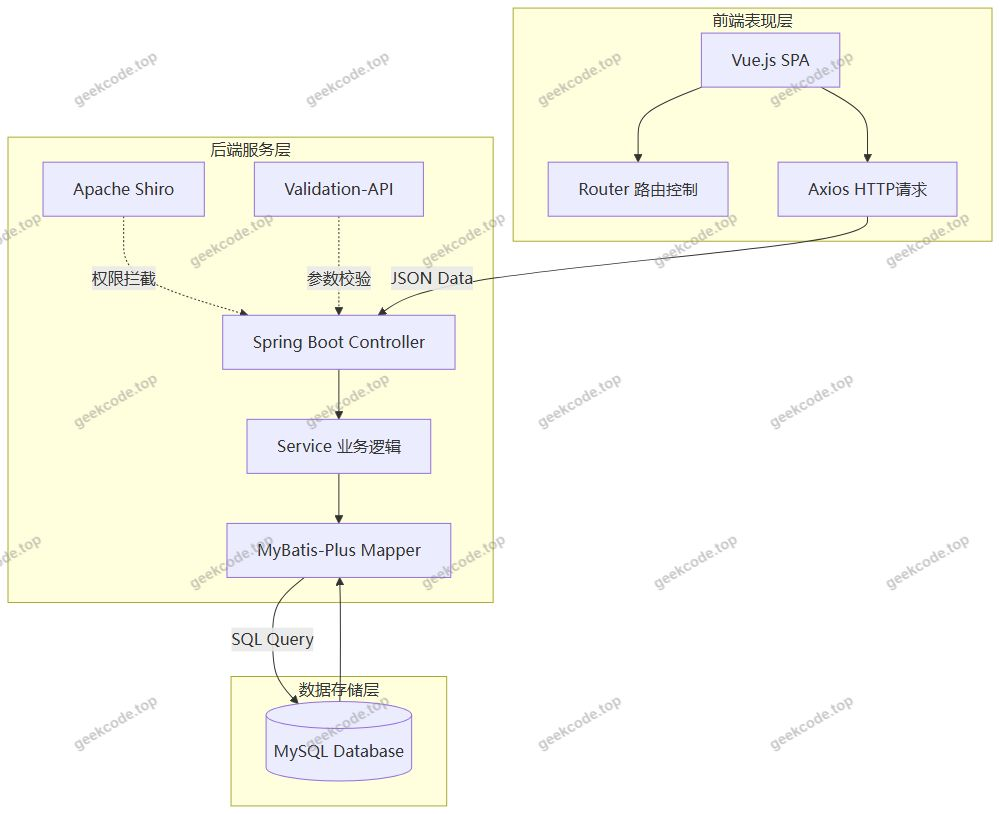
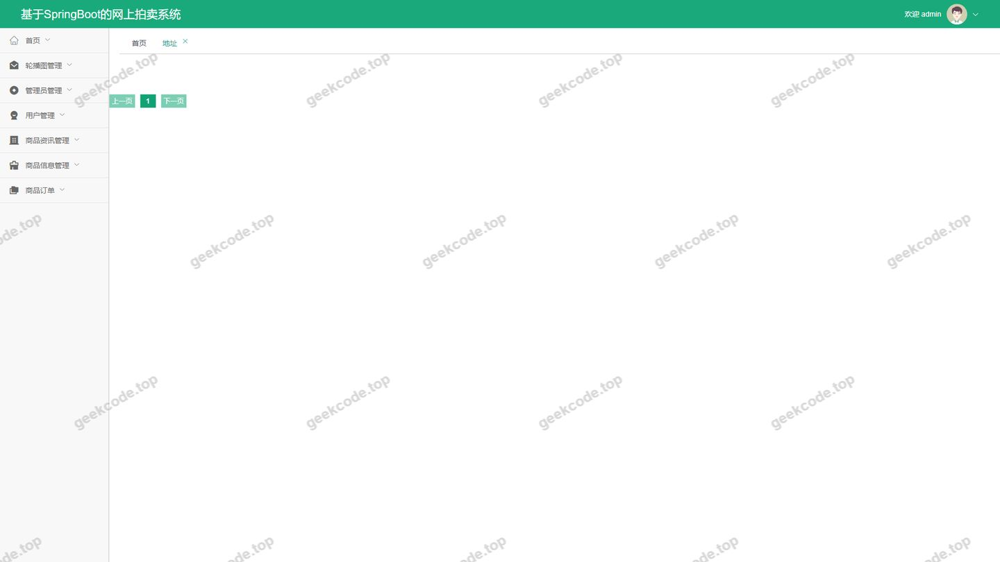
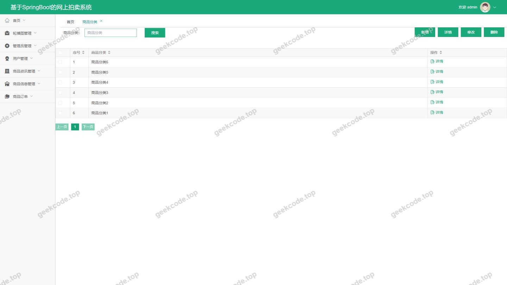
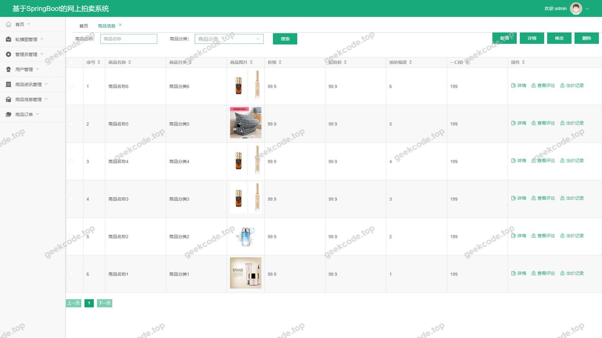
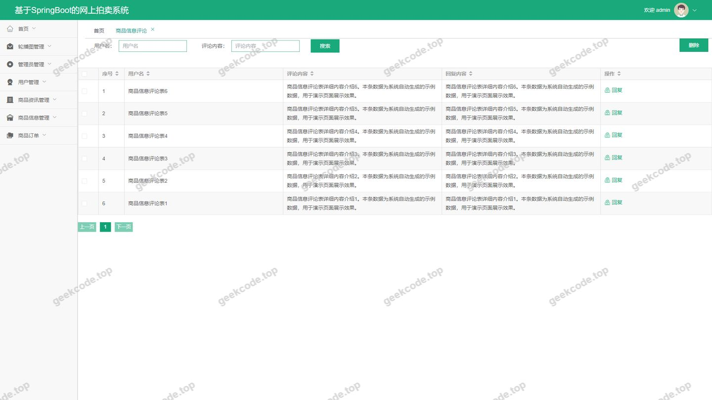
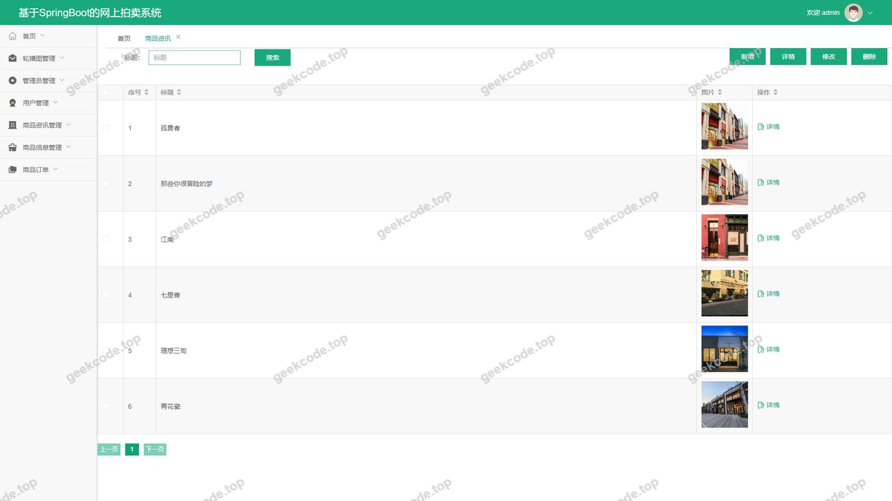
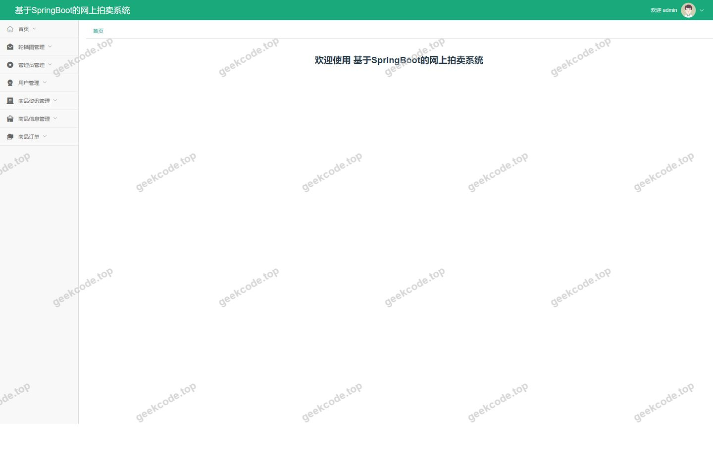
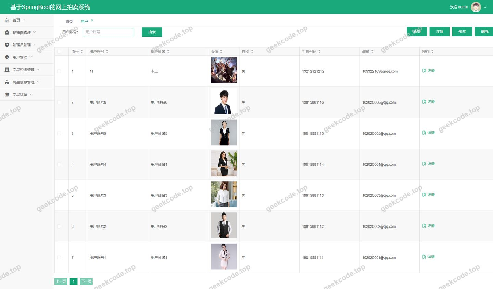

# [springboot]基于SpringBoot的网上拍卖系统

> 🎓 **计算机毕业设计 · [springboot]基于SpringBoot的网上拍卖系统**
>
> 本仓库只放**项目介绍 + 运行截图**（截图是站点带水印的原图，存在仓库 `images/` 里）。
>
> 👉 **完整可运行源码 / 数据库脚本 / 部署文档：[点我获取](https://geekcode.top/archives/springboot-%E5%9F%BA%E4%BA%8ESpringBoot%E7%9A%84%E7%BD%91%E4%B8%8A%E6%8B%8D%E5%8D%96%E7%B3%BB%E7%BB%9F?utm_source=github)**
>
> 💬 咨询微信：**ir9372**　|　🌐 更多项目：[极客代码 geekcode.top](https://geekcode.top/?utm_source=github)
>
> 📌 项目详情页：<https://geekcode.top/archives/springboot-%E5%9F%BA%E4%BA%8ESpringBoot%E7%9A%84%E7%BD%91%E4%B8%8A%E6%8B%8D%E5%8D%96%E7%B3%BB%E7%BB%9F?utm_source=github>

<table><td width="230" align="center"> <b>扫码加微信 ir9372</b></td><td valign="middle">📦 源码 = 项目介绍 + 全部运行截图 + 数据库 + 部署文档 👉 点上方任意截图，直接跳到 <b>极客代码 geekcode.top</b> 详情页</td></table>

---

<h1>[springboot]基于SpringBoot的网上拍卖系统</h1>
<h2>项目概述</h2>

本项目为基于 Spring Boot 的网上拍卖系统，旨在构建一个集商品展示、在线竞拍、订单管理及用户互动于一体的电子商务平台。系统采用前后端分离架构，后端基于 Spring Boot 框架结合 MyBatis-Plus 实现高效的数据持久化与业务逻辑处理，引入 Apache Shiro 进行安全认证与授权管理；前端采用 Vue.js 技术栈构建响应式界面。核心功能涵盖用户注册登录、商品分类浏览、拍卖信息管理、购物车收藏、地址管理、订单确认及后台数据维护等模块。适用人群包括普通消费者（买家）与系统管理员。该系统解决了传统电商在特定场景下缺乏灵活竞价机制的问题，通过标准化的后台管理流程保障数据一致性，适用于中小型垂直领域的在线拍卖业务场景，具备高并发下的稳定性与良好的用户体验。

<h2>技术架构</h2>
<h3>总体架构</h3>

系统采用经典的前后端分离模式（Vue-Separate），通过 RESTful API 进行通信。整体架构分为表现层、业务逻辑层、数据访问层和基础设施层。

<h3>核心技术选型理由</h3>
<ol>
<li><strong>Spring Boot</strong>：作为后端基础框架，利用其自动配置特性简化了 Web 容器（Tomcat）、JDBC 驱动及第三方库的集成过程，提升了开发效率与维护性。</li>
<li><strong>MyBatis-Plus</strong>：在 MyBatis 基础上增强，提供了通用的 CRUD 操作接口和条件构造器，大幅减少了样板代码，同时支持复杂的 SQL 自定义查询，兼顾了开发速度与灵活性。</li>
<li><strong>Apache Shiro</strong>：轻量级且强大的 Java 安全框架，负责系统的身份认证（Authentication）、授权（Authorization）及会话管理，确保不同角色（如 admin, yonghu）只能访问其权限范围内的资源。</li>
<li><strong>MySQL Connector &amp; JDBC</strong>：使用标准的 JDBC 连接池配合 MySQL 数据库，保证数据读写的高可靠性与事务完整性。</li>
<li><strong>Protobuf &amp; Commons-Lang3</strong>：引入 Protobuf 用于高性能序列化场景（如有需要），Commons-Lang3 提供丰富的工具类以优化字符串处理与对象操作。</li>
</ol>
<h3>数据库设计要点</h3>

数据库主要围绕“用户”、“商品”、“拍卖”、“订单”四大实体构建。

<ul>
<li><strong>用户表 (yonghu)</strong>：存储用户基本信息及状态。</li>
<li><strong>商品信息表 (shangpinxinxi)</strong>：包含商品详情、价格、库存及关联的分类 ID。</li>
<li><strong>商品分类表 (shangpinfenlei)</strong>：用于商品的层级化管理。</li>
<li><strong>拍卖信息表 (auctionshangpinxinxi)</strong>：记录参与拍卖的商品及其当前出价、起拍价等动态数据。</li>
<li><strong>订单表 (orders)</strong>：关联用户、商品及收货地址，记录交易状态。</li>
<li><strong>地址表 (address)</strong>：存储用户的收货地址信息。</li>
<li><strong>评论表 (discussshangpinxinxi)</strong>：记录用户对已购或浏览商品的反馈。</li>
<li><strong>配置表 (config/users)</strong>：分别管理系统全局配置参数与后台管理员账户信息。</li>
</ul>
<h2>功能模块</h2>

根据源码路由配置，系统功能划分为前台用户端与后台管理端两大模块。

<h3>前台用户端功能</h3>

前台面向注册用户，提供完整的浏览、交互与交易流程。

<table>
<thead>
<tr>
<th align="left">模块名称</th>
<th align="left">功能描述</th>
</tr>
</thead>
<tbody><tr>
<td align="left"><strong>首页资讯</strong> (<code>/index/newsList</code>)</td>
<td align="left">展示最新发布的商品资讯或系统公告，引导用户关注热点内容。</td>
</tr>
<tr>
<td align="left"><strong>用户中心</strong> (<code>/index/yonghuCenter</code>, <code>/index/yonghuDetail</code>, <code>/index/yonghuAdd</code>)</td>
<td align="left">允许用户查看个人信息、修改资料以及新增用户档案。</td>
</tr>
<tr>
<td align="left"><strong>商品分类浏览</strong> (<code>/index/shangpinfenleiList</code>, <code>/index/shangpinfenleiDetail</code>)</td>
<td align="left">按类别筛选商品，查看分类详情，帮助用户快速定位目标物品。</td>
</tr>
<tr>
<td align="left"><strong>商品信息展示</strong> (<code>/index/shangpinxinxiList</code>, <code>/index/shangpinxinxiDetail</code>)</td>
<td align="left">列表页展示所有商品概要，详情页呈现图片、描述、价格等完整信息。</td>
</tr>
<tr>
<td align="left"><strong>拍卖专区</strong> (<code>/index/auctionshangpinxinxiList</code>, <code>/index/auctionshangpinxinxiDetail</code>)</td>
<td align="left">专门展示处于拍卖状态的商品，支持查看拍卖规则与当前最高价。</td>
</tr>
<tr>
<td align="left"><strong>我的收藏</strong> (<code>/index/storeupList</code>)</td>
<td align="left">用户可查看之前加入“收藏夹”的商品列表，便于后续回访。</td>
</tr>
<tr>
<td align="left"><strong>地址管理</strong> (<code>/index/addressList</code>)</td>
<td align="left">增删改查用户的收货地址，供下单时使用。</td>
</tr>
<tr>
<td align="left"><strong>邮箱验证码</strong> (<code>/index/emailregistercodeList</code> 等)</td>
<td align="left">处理注册或找回密码时的邮件验证逻辑，确保账户安全性。</td>
</tr>
<tr>
<td align="left"><strong>订单确认</strong> (<code>/index/order_confirm</code>)</td>
<td align="left">用户在提交订单前核对商品、数量、金额及收货地址的关键页面。</td>
</tr>
<tr>
<td align="left"><strong>我的订单</strong> (<code>/index/ordersList</code>)</td>
<td align="left">查看历史订单记录及当前订单状态（如待支付、已完成）。</td>
</tr>
<tr>
<td align="left"><strong>用户注册</strong> (<code>/yonghuRegister</code>)</td>
<td align="left">新用户创建账号的入口，通常包含表单验证与协议同意环节。</td>
</tr>
</tbody></table>
<h3>后台管理端功能</h3>

后台面向管理员，提供全量数据的维护与管理能力。

<table>
<thead>
<tr>
<th align="left">模块名称</th>
<th align="left">路由路径</th>
<th align="left">功能描述</th>
</tr>
</thead>
<tbody><tr>
<td align="left"><strong>系统登录</strong></td>
<td align="left"><code>/login</code> (隐含)</td>
<td align="left">管理员通过用户名密码进入后台控制台。</td>
</tr>
<tr>
<td align="left"><strong>首页仪表盘</strong></td>
<td align="left"><code>/home</code> (隐含)</td>
<td align="left">展示关键业务指标概览，如今日订单数、新增用户数等。</td>
</tr>
<tr>
<td align="left"><strong>新闻管理</strong></td>
<td align="left"><code>/news</code></td>
<td align="left">发布、编辑或删除前台展示的商品资讯与公告。</td>
</tr>
<tr>
<td align="left"><strong>地址管理</strong></td>
<td align="left"><code>/address</code></td>
<td align="left">查看和管理所有用户的收货地址数据（通常为只读或高级干预）。</td>
</tr>
<tr>
<td align="left"><strong>用户管理</strong></td>
<td align="left"><code>/yonghu</code></td>
<td align="left">查询、禁用、删除或重置普通用户账户信息。</td>
</tr>
<tr>
<td align="left"><strong>分类管理</strong></td>
<td align="left"><code>/shangpinfenlei</code></td>
<td align="left">维护商品分类树结构，添加新类别或调整排序。</td>
</tr>
<tr>
<td align="left"><strong>评论管理</strong></td>
<td align="left"><code>/discussshangpinxinxi</code></td>
<td align="left">审核用户提交的评论，支持删除违规或不实评价。</td>
</tr>
<tr>
<td align="left"><strong>商品管理</strong></td>
<td align="left"><code>/shangpinxinxi</code></td>
<td align="left">上架、下架、编辑普通商品信息，包括图片上传与详情富文本编辑。</td>
</tr>
<tr>
<td align="left"><strong>拍卖管理</strong></td>
<td align="left"><code>/auctionshangpinxinxi</code></td>
<td align="left">创建拍卖活动，设置起拍价、保证金及结束时间，监控拍卖进程。</td>
</tr>
<tr>
<td align="left"><strong>订单管理</strong></td>
<td align="left"><code>/orders</code></td>
<td align="left">查看所有交易订单，处理退款申请或标记发货状态。</td>
</tr>
<tr>
<td align="left"><strong>收藏管理</strong></td>
<td align="left"><code>/storeup</code></td>
<td align="left">查看用户的收藏记录，分析热门商品趋势。</td>
</tr>
<tr>
<td align="left"><strong>系统配置</strong></td>
<td align="left"><code>/config</code></td>
<td align="left">修改网站名称、Logo、联系方式等全局静态配置。</td>
</tr>
<tr>
<td align="left"><strong>管理员管理</strong></td>
<td align="left"><code>/users</code></td>
<td align="left">添加新的后台管理员账号，分配初始权限。</td>
</tr>
</tbody></table>
<h2>用户角色与权限</h2>

系统基于 Apache Shiro 实现细粒度的权限控制，主要定义两类角色：<strong>普通用户 (User)</strong> 和 <strong>系统管理员 (Admin)</strong>。

<h3>1. 普通用户 (Role: User)</h3>

普通用户是系统的主要服务对象，拥有自助操作权限，但无法直接修改底层数据或访问管理接口。

<ul>
<li><strong>认证与账户管理</strong>：</li>
<li>执行注册 (<code>/yonghuRegister</code>)、登录操作。</li>
<li>修改个人基本信息 (<code>/index/yonghuDetail</code>, <code>/index/yonghuAdd</code>)。</li>
<li>管理收货地址 (<code>/index/addressList</code>)。</li>
<li><strong>浏览与搜索</strong>：</li>
<li>浏览首页资讯 (<code>/index/newsList</code>)。</li>
<li>查看商品分类 (<code>/index/shangpinfenleiList</code>) 及其详情。</li>
<li>浏览普通商品 (<code>/index/shangpinxinxiList</code>) 和拍卖商品 (<code>/index/auctionshangpinxinxiList</code>)。</li>
<li><strong>交易与互动</strong>：</li>
<li>将商品加入收藏夹 (<code>/index/storeupList</code>)。</li>
<li>参与订单确认流程 (<code>/index/order_confirm</code>)。</li>
<li>查看自己的历史订单 (<code>/index/ordersList</code>)。</li>
<li>发表商品评论（对应前台评论提交接口，虽无独立路由显示，但属于用户行为范畴）。</li>
</ul>
<h3>2. 系统管理员 (Role: Admin)</h3>

管理员拥有最高权限，可对系统内所有数据进行 CRUD（增删改查）操作，并监控系统运行状态。

<ul>
<li><strong>内容管理</strong>：</li>
<li>发布与维护新闻资讯 (<code>/news</code>)。</li>
<li>管理商品分类体系 (<code>/shangpinfenlei</code>)。</li>
<li>上架/下架/编辑普通商品信息 (<code>/shangpinxinxi</code>)。</li>
<li>创建/编辑/终止拍卖活动 (<code>/auctionshangpinxinxi</code>)。</li>
<li><strong>用户与社区管理</strong>：</li>
<li>管理普通用户账户，包括封禁或解封 (<code>/yonghu</code>)。</li>
<li>审核与管理用户评论，维护社区秩序 (<code>/discussshangpinxinxi</code>)。</li>
<li>查看用户收藏数据以辅助运营决策 (<code>/storeup</code>)。</li>
<li><strong>交易与系统运维</strong>：</li>
<li>处理所有订单状态，包括异常订单介入 (<code>/orders</code>)。</li>
<li>查看用户地址数据 (<code>/address</code>)。</li>
<li>配置系统全局参数 (<code>/config</code>)。</li>
<li>管理其他管理员账号 (<code>/users</code>)。</li>
</ul>
<h2>项目特色与创新点</h2>
<ol>
<li>
<strong>双轨制商品管理模式</strong>：
   系统将“普通商品” (<code>shangpinxinxi</code>) 与“拍卖商品” (<code>auctionshangpinxinxi</code>) 分离设计。这种架构允许平台同时支持固定价格销售和动态竞价两种商业模式，满足了多样化交易需求，比单一模式的电商系统更具商业灵活性。

</li>
<li>
<strong>基于 Shiro 的安全隔离机制</strong>：
   引入 Apache Shiro 而非简单的过滤器链，实现了更精细的 RBAC（基于角色的访问控制）。通过注解或配置方式保护后台敏感接口，防止未授权访问，确保了管理员数据与普通用户数据之间的严格隔离，提升了系统的安全性。

</li>
<li>
<strong>前后端分离的高效协作</strong>：
   采用 Vue-Separate 架构，前端专注于视图渲染与交互体验，后端专注于业务逻辑与数据处理。这种解耦使得系统易于扩展，例如未来若需增加移动端 App，可直接复用后端 API，无需重写业务逻辑。

</li>
<li>
<strong>完善的闭环交易流程</strong>：
   从用户浏览、收藏、地址管理到最终的订单确认，系统构建了完整的购物闭环。特别是 <code>order_confirm</code> 页面的存在，强化了交易前的信息核对环节，降低了误操作导致的纠纷率，体现了以用户体验为中心的设计思路。

</li>
</ol>
<h2>部署环境</h2>

为确保系统正常运行，需准备以下软件环境与依赖：

<h3>硬件环境建议</h3>
<ul>
<li><strong>CPU</strong>: Intel Core i5 及以上</li>
<li><strong>内存</strong>: 8GB RAM 及以上</li>
<li><strong>硬盘</strong>: 至少 50GB 可用空间</li>
</ul>
<h3>软件环境要求</h3>
<table>
<thead>
<tr>
<th align="left">组件</th>
<th align="left">版本要求</th>
<th align="left">说明</th>
</tr>
</thead>
<tbody><tr>
<td align="left"><strong>操作系统</strong></td>
<td align="left">Windows 10/11, Linux (CentOS 7+), macOS</td>
<td align="left">推荐 Linux 用于生产环境部署</td>
</tr>
<tr>
<td align="left"><strong>Java JDK</strong></td>
<td align="left">JDK 1.8</td>
<td align="left">Spring Boot 及 MyBatis 兼容的基础运行环境</td>
</tr>
<tr>
<td align="left"><strong>Maven</strong></td>
<td align="left">3.6+</td>
<td align="left">用于后端项目的依赖管理与打包构建</td>
</tr>
<tr>
<td align="left"><strong>Node.js</strong></td>
<td align="left">14.x - 16.x LTS</td>
<td align="left">用于前端 Vue 项目的依赖安装 (<code>npm install</code>) 与编译 (<code>npm run build</code>)</td>
</tr>
<tr>
<td align="left"><strong>MySQL</strong></td>
<td align="left">5.7+ 或 8.0+</td>
<td align="left">关系型数据库，需导入项目提供的 <code>.sql</code> 初始化脚本</td>
</tr>
<tr>
<td align="left"><strong>IDE</strong></td>
<td align="left">IntelliJ IDEA / Eclipse</td>
<td align="left">后端开发调试工具</td>
</tr>
<tr>
<td align="left"><strong>编辑器</strong></td>
<td align="left">VS Code / WebStorm</td>
<td align="left">前端代码编写工具</td>
</tr>
<tr>
<td align="left"><strong>浏览器</strong></td>
<td align="left">Chrome / Edge / Firefox</td>
<td align="left">现代浏览器，支持 ES6+ 语法，用于访问系统</td>
</tr>
</tbody></table>
<h3>部署步骤简述</h3>
<ol>
<li><strong>数据库初始化</strong>：启动 MySQL 服务，创建数据库，执行项目根目录下的 SQL 脚本建立表结构与初始数据。</li>
<li><strong>后端部署</strong>：修改 <code>application.yml</code> 中的数据库连接信息（URL、用户名、密码），使用 Maven 命令 <code>mvn clean package</code> 打包生成 jar 文件，通过 <code>java -jar</code> 命令启动服务。</li>
<li><strong>前端部署</strong>：进入前端目录，执行 <code>npm install</code> 安装依赖，配置 <code>vue.config.js</code> 中的代理地址指向后端服务器 IP，执行 <code>npm run serve</code> 进行本地测试或 <code>npm run build</code> 生成静态资源包，最后通过 Nginx 或 Tomcat 托管静态文件。</li>
</ol>
<h2>五、技术特性</h2>
<ul>
<li>前后端分离架构，前端独立部署</li>
<li>使用 MyBatis-Plus 简化数据访问层开发</li>
<li>集成 Shiro 权限框架实现角色权限控制</li>
</ul>
<h2>六、功能模块截图</h2>
<h3>后台管理端</h3>
<h4>后台-地址</h4>

<h4>后台-登录页</h4>

<h4>后台-商品分类</h4>

<h4>后台-商品信息</h4>

<h4>后台-商品信息评论</h4>

<h4>后台-商品资讯</h4>

<h4>后台首页</h4>

<h4>后台-用户</h4>

---

## 获取完整源码

| 项目 | 说明 |
| --- | --- |
| 项目名 | [springboot]基于SpringBoot的网上拍卖系统 |
| 运行截图 | 本文 9 张（站点带水印原图，仓库 `images/` 目录） |
| 完整源码 | [https://geekcode.top/archives/springboot-%E5%9F%BA%E4%BA%8ESpringBoot%E7%9A%84%E7%BD%91%E4%B8%8A%E6%8B%8D%E5%8D%96%E7%B3%BB%E7%BB%9F?utm_source=github](https://geekcode.top/archives/springboot-%E5%9F%BA%E4%BA%8ESpringBoot%E7%9A%84%E7%BD%91%E4%B8%8A%E6%8B%8D%E5%8D%96%E7%B3%BB%E7%BB%9F?utm_source=github) |
| 咨询微信 | **ir9372**（备注：jingpin-yuanma） |
| 更多项目 | [极客代码 geekcode.top](https://geekcode.top/?utm_source=github) |

> 需要源码、部署、改配置、跑不起来等问题，加微信 ir9372 沟通，说明项目名即可。
